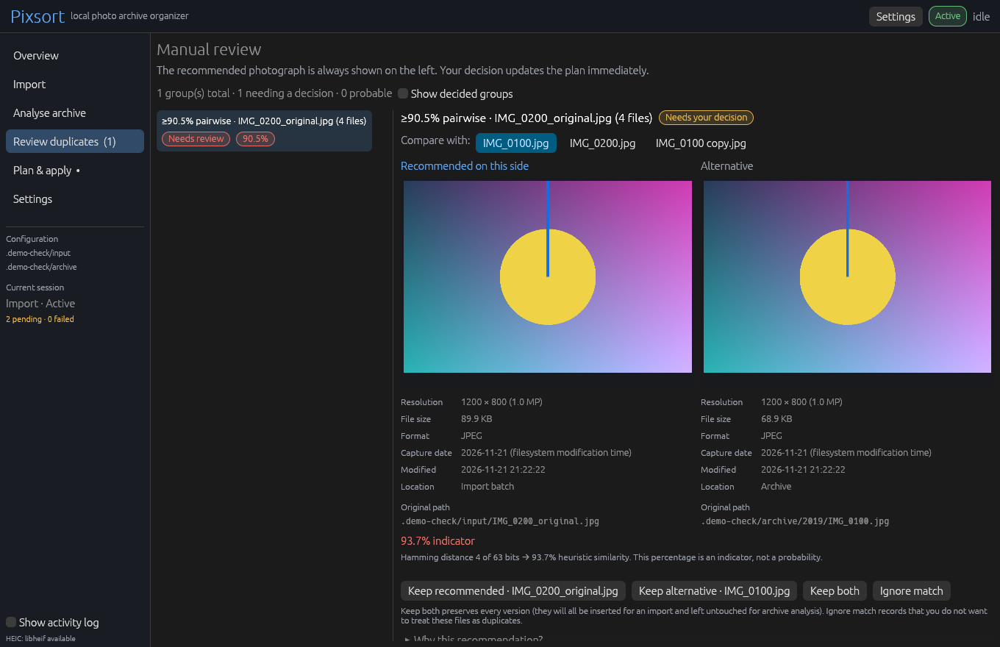

# Pixsort

Pixsort is a **local-native desktop application** for organizing and
deduplicating large photo collections. It indexes existing archives, imports
new photographs, finds exact and perceptual duplicates, recommends which
version to keep, and prepares a complete modification plan **before touching
any original file**.

Built with Rust, egui/eframe and SQLite. No network services, no cloud, no AI
or machine-learning models.



## Features

- **Exact pixel duplicates** — SHA-256 over a normalized decoded pixel
  representation (EXIF orientation applied, RGB8, alpha composited, dimensions
  included). Metadata, filenames and encodings do not matter.
- **Perceptual duplicates** — 63-bit DCT pHash with Hamming distance. Detects
  resized, recompressed and re-encoded copies such as messaging-app versions.
  Groups are boundedly coherent (complete-linkage), size-capped, and never
  created by transitive chaining of weak matches.
- **Explainable recommendations** — resolution, capture-date reliability and
  age, metadata completeness, dates in filenames and file size, every point
  shown with its reason.
- **Manual review** — side-by-side comparison with the recommendation always on
  the left; keep left/right, keep both, or ignore. Decisions are persisted.
  Legacy plans produced by an older grouping algorithm are refused until the
  archive is analysed again.
- **Import workflow** — index the archive and the batch, compare only
  new-vs-archive and new-vs-new, classify, build a plan, preview, approve, apply.
- **Archive analysis mode** — find duplicate groups across an existing archive
  using stored hashes only, with a BK-tree for perceptual candidates.
- **Safe execution** — verified copies, no silent overwrites, deduplicated
  destination names, configurable trash instead of deletion, interrupted-
  operation recovery, and a write-access preflight that refuses to start when a
  folder it must write to (or the trash) is not writable.
- **Resumable and parallel** — cached hashes reused when size/mtime are
  unchanged; configurable worker threads; pause, resume and stop; every file is
  recorded as pending before work starts.
- **Two temporary SQLite databases**, independently located from each other and
  from the archive, with an explicit session lifecycle.
- **Native folder dialogs** on Linux via Zenity (fallback: KDialog, then a
  built-in directory browser).

## Requirements

- Rust **1.95+** (edition 2021).
- Linux: an X11 or Wayland session with OpenGL (the app uses the eframe `glow`
  renderer), plus the usual windowing libraries. No GTK development packages
  are required.
- Optional: `zenity` or `kdialog` for native folder dialogs.
- Optional: `libheif` for HEIC/HEIF decoding. Pixsort loads it at runtime; if it
  is missing, the rest of the application works and HEIC files are reported as
  failed with a clear message. Set `PIXSORT_LIBHEIF` to a specific library path
  if it is installed in an unusual location.
- SQLite is compiled in (`rusqlite` bundled): a C compiler (`cc`) is required
  for the build, but no system SQLite is needed.

## Build and run

```sh
cargo build --release
./target/release/pixsort
```

For development:

```sh
cargo run
cargo test
```

Settings are stored in the platform configuration directory
(`$XDG_CONFIG_HOME/pixsort/settings.json` on Linux, `%APPDATA%\Pixsort` on
Windows). Override it with `PIXSORT_CONFIG_DIR` for portable/testing setups.

Create a small demo project with synthetic photographs:

```sh
cargo run --example prepare_demo -- .demo
PIXSORT_CONFIG_DIR=.demo/config cargo run
```

## Using Pixsort

1. **Settings** — choose four independent locations: the import folder, the
   archive root, the image-index database file, and the modification-plan
   database file. Choose a trash folder (by default a sibling of the archive
   root, outside the archive). The databases may live on different disks and
   must not be placed inside the archive.
2. **Import** — press *Start import*. Pixsort indexes the archive, indexes the
   input folder (reusing unchanged hashes), compares each imported photograph
   against the archive and against the rest of the batch, and writes a plan.
3. **Manual review** — every perceptual match waits for your decision. Exact
   duplicates are resolved from metadata automatically, but can also be changed.
4. **Planned modifications** — inspect inserts, replacements, skips, trash moves
   and unresolved reviews. The plan is the desired final state, not a pile of
   independent decisions. If the archive is on a NAS, the trash folder can be a
   writable local folder (Settings → Trash folder → *Use local trash folder*);
   the files are moved with a verified copy across filesystems.
5. **Apply** — only after ticking the explicit approval box does Pixsort modify
   the archive. Failed or interrupted operations can be retried; completed work
   is never repeated.

Archive analysis is a separate, read-only mode for finding duplicates in an
existing archive. It never scans the input folder and never modifies files until
you approve a generated plan.

### Group safety

Perceptual groups are intentionally conservative: matches must be mutually
coherent at the configured radius (complete-linkage), groups are capped at 10
photographs by default, and weak chains cannot pull unrelated photographs into
one group. The default grouping/review threshold is 85% (configurable). If a
group is not really a set of versions, use **Ignore match** — it produces no
operations. Changing thresholds affects the next analysis; rerun Archive
analysis to regroup an existing plan.

Plans created by the older unbounded grouping algorithm are marked legacy and
refused for review/apply. Discard the session (database files and photos are
kept) and rerun the analysis.

## Architecture

The crate is split into small modules with a one-directional dependency flow:

```
imaging → db → scan / compare / recommend / planner → import / analysis → executor → ui
```

See:

- [Architecture and database schemas](docs/architecture.md)
- [Normalization, hashing and similarity policies](docs/policies.md)
- [Filesystem safety, recovery and ambiguity decisions](docs/safety.md)

## Tests

The test suite covers the scenarios required by the project specification:

- exact duplicates with different metadata, formats and filenames,
- different resolutions,
- recompressed and messaging-style resized/recompressed images,
- EXIF orientation,
- missing metadata,
- multiple duplicates in one import batch,
- interrupted operations and reconciliation,
- resuming scans and cached-hash reuse,
- filename conflicts at planning and execution time,
- destination mismatch/reconnect safety,
- Unicode and space-containing paths,
- database corruption reporting.

Run:

```sh
cargo test
```

The BK-tree candidate search is also exercised against 30,000 perceptual hashes.

## Permissions and sudo

Pixsort never asks for `sudo` and should not be run as root. A read-only or
restricted NAS mount cannot be fixed by privilege escalation, and running an
image decoder with root privileges is unsafe. Fix the mount/folder permissions,
or choose a writable trash folder. Apply performs a write-access preflight before
touching anything and reports exactly which path failed.

## Scope and non-goals

Pixsort deliberately does **not** implement crop matching, object recognition,
semantic similarity, advanced feature matching, AI-based recognition, video
processing, a web interface or network services. It targets different technical
versions of the same photograph.

HEIC support is optional at runtime; GIF is not treated as a photograph format.
Animated PNG/WebP files are analysed from their first frame only and flagged in
the metadata. Non-UTF-8 path names are skipped with a warning; paths containing
spaces and Unicode are fully supported.

## License

MIT — see [LICENSE](LICENSE).
